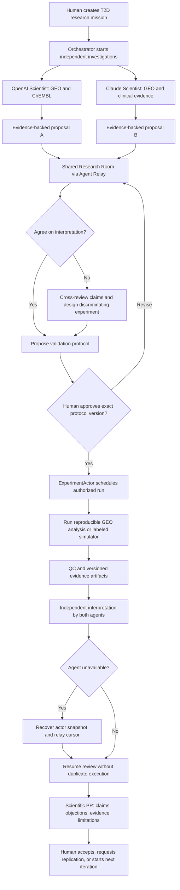

# CureLab — Product Workflow & Experience Specification

**Role:** Product Manager, AI for Science  
**Version:** 1.0 | **Date:** 2026-10-31  
**First mission:** Type 2 Diabetes (T2D) drug repurposing and pancreatic β-cell functional research

## 1. Product thesis

**Problem:** AI scientists can generate hypotheses rapidly, but independent agents, human researchers, evidence, and experiment execution are fragmented. There is no dependable shared workflow that preserves independent judgment, makes experiments reproducible, captures disagreements, and continues when an agent goes offline.

**Solution:** CureLab is a persistent, cross-provider research workspace where independent AI scientists and humans can investigate a mission, exchange evidence, challenge claims, design and execute authorized experiments, and publish a reviewable **Scientific Pull Request (Scientific PR)**.

**Tagline:** *Different AI scientists. One shared laboratory. Research that survives its researchers.*

**Scope truth:** In the hackathon, biological datasets are historical public observations; new virtual-wet-lab measurements are **simulated**, and computational reanalyses are **computed**. None demonstrate a T2D cure or clinical efficacy.

## 2. Target users and jobs to be done

| Persona | Job to be done | Key concern |
|---|---|---|
| Principal Investigator (human) | Define research question, authorize experiments, review evidence | Scientific validity and control |
| AI Scientist A (OpenAI-backed) | Independently propose candidate hypotheses and supporting evidence | Reliable data access |
| AI Scientist B (Claude-backed) | Independently investigate, challenge and replicate conclusions | Independence from Agent A |
| Research reviewer | Reproduce analysis and inspect provenance | Traceability and uncertainty |
| Lab operator (future) | Execute approved physical protocols | Safety, permissions, real-world idempotency |

## 3. End-to-end workflow



## 4. Workflow stages: user-visible experience

| Stage | User sees | AI/system action | Exit criterion |
|---|---|---|---|
| 1. Mission creation | Question, disease, outcome, data policy | Create MissionActor; assign stable mission ID | Mission persisted |
| 2. Independent discovery | Two separate progress cards; no premature sharing | Separate provider calls and evidence tools | Two independently submitted proposals |
| 3. Research room | Evidence cards, claims, citations, dissent thread | Relay exchanges structured proposals and critiques | Reviewable experiment question |
| 4. Protocol review | Proposed controls, readouts, dataset, limitations, budget | Version protocol; enforce policy | Human approves exact version |
| 5. Living experiment | Run state, results chart, QC, provenance labels | Trusted worker executes deterministic computation/simulation | Result artifacts and QC committed |
| 6. Recovery | Offline badge, ongoing run, resumed agent | Reload actor state, reconcile messages and work | No duplicate run; agent responds to new evidence |
| 7. Scientific PR | Claim diff, support/contradiction, results, next steps | Assemble review package | Human review decision |

## 5. Key screens (PM wireframe)

```text
┌──────────────────────────────────────────────────────────────────────────────┐
│ CureLab  /  Mission T2D-001                        [Live] [Share] [Export PR] │
├───────────────────┬──────────────────────────┬───────────────────────────────┤
│ RESEARCH MISSION  │ SHARED RESEARCH ROOM     │ LIVING EXPERIMENT             │
│ Goal / criteria   │ OpenAI Scientist        │ Protocol v3 [Approved]        │
│ Data sources      │   Hypothesis A + cite   │ State: RUNNING / QC_REVIEW    │
│ Open questions    │ Claude Scientist        │ Controls + simulated plate    │
│ Hypothesis A/B    │   Critique + cite       │ Results + quality checks      │
│                   │ Human PI                │ Evidence provenance          │
│                   │   Approve protocol      │ [Pause] [Inspect] [Re-run]    │
├───────────────────┴──────────────────────────┴───────────────────────────────┤
│ SCIENTIFIC PR: Claim | Supporting evidence | Objections | Reproducibility   │
└──────────────────────────────────────────────────────────────────────────────┘
```

### Core interaction requirements

- **Independent mode:** Agents cannot read each other's draft until both submit signed/attributed proposals.
- **Evidence-first cards:** Every substantive claim links to dataset/accession, tool output, or literature; unsupported statements are flagged.
- **Human control:** Only a human with approval permission can authorize an experiment version.
- **Clear provenance:** Show **Observed public data**, **Computed analysis**, **Simulated measurement**, or **Literature claim** on every artifact.
- **Persistent mission:** Closing a browser or restarting an agent does not erase committed mission state.
- **Disagreement is a feature:** Preserve dissent and unresolved questions rather than forcing consensus.

## 6. Example mission and demonstration

**Research question:** Which existing compounds deserve further study for improving pancreatic β-cell function in T2D?

1. OpenAI scientist searches **GSE81608** β-cell expression patterns and ChEMBL target evidence; submits a candidate with limitations.
2. Claude scientist independently checks **GSE41762** and clinical-study evidence; may find that a reported effect lacks adequate controls or is not β-cell-specific.
3. Agents enter the shared room, exchange their findings, and propose a discriminating experiment.
4. Human PI approves a **specific protocol version** with appropriate controls.
5. Trusted execution worker runs either a real dataset reanalysis or a clearly marked **seeded virtual β-cell assay**. LLMs interpret but do not fabricate measurements.
6. Kill the OpenAI worker process. Claude continues reviewing evidence while the experiment state remains durable.
7. Restart OpenAI, reconcile missed messages and evidence, and generate a Scientific PR retaining both viewpoints.

**Do not claim:** newly discovered drug, physical wet-lab validation, improved patient outcomes, or proven cure.

## 7. Dataset and open-source integration map

| Capability | Preferred resource | MVP use | Notes |
|---|---|---|---|
| T2D single-cell expression | [GSE81608](https://www.ncbi.nlm.nih.gov/geo/query/acc.cgi?acc=GSE81608) | One curated β-cell analysis | Respect donor-level dependence |
| Independent human islet expression | [GSE41762](https://www.ncbi.nlm.nih.gov/geo/query/acc.cgi?acc=GSE41762) | Cross-study direction check | Different technology; do not concatenate raw matrices |
| Drug/target activity | [ChEMBL](https://www.ebi.ac.uk/chembl/) | Evidence-backed target/compound lookup | Activity does not establish therapeutic benefit |
| Human islet physiology | [HPAP](https://hpap.pmacs.upenn.edu/) | Post-hackathon | Check access and data-use rules |
| Perturbation signatures | [LINCS](https://lincsproject.org/) | Post-hackathon | Cell-type and dose limitations |
| Clinical trial registry | [ClinicalTrials.gov](https://clinicaltrials.gov/) | Optional evidence check | Registry is not a success predictor |
| Scientific tool gateway | [ToolUniverse](https://github.com/mims-harvard/ToolUniverse) | Selected read-only tools | Pin versions and audit calls |
| Scientific workflows | [LabClaw](https://github.com/wu-yc/LabClaw) | Reference relevant skills | Inspect individual skill dependencies/licenses |
| Drug research workflows | [DrugClaw](https://github.com/QSong-github/DrugClaw) | Reference drug repurposing/safety flows | Verify current availability before adopting |
| Drug repurposing research | [TxGNN](https://github.com/mims-harvard/TxGNN) | Optional candidate ranking | Predictions are hypotheses |
| Therapeutic benchmarks | [TDC](https://github.com/mims-harvard/TDC) | Later evaluation | Avoid training a new model in the hackathon |

## 8. MVP prioritization

### P0 — must work in demo

1. One mission and one shared room with **two genuinely separate provider-backed agents** and a human.
2. Independent evidence-backed initial proposals.
3. Structured Agent Relay messages and real disagreement.
4. Human-approved protocol version.
5. One executable deterministic experiment, provenance labels and QC.
6. Durable experiment state and **actual worker termination/restart**.
7. Scientific PR summarizing claims, counterevidence, methods and limitations.

### P1 — next iteration

- Clinical-trial evidence agent; drug interaction safety agent; independent dataset replication; reusable skills registry; Mearc Research Passport.

### Out of scope for hackathon

- Autonomous physical wet-lab control, patient treatment recommendations, new model training, automatic clinical success prediction, unrestricted third-party ChatGPT/Claude session access.

## 9. Success metrics and acceptance criteria

| Objective | Acceptance test |
|---|---|
| Cross-provider collaboration | Show distinct OpenAI and Anthropic API requests, identities, and structured relay exchange |
| Independent scientific judgment | Initial reports submitted before cross-reading; visible, evidence-based critique |
| Real computation | Changing an input/seed changes a computed/simulated result; same inputs reproduce the result |
| Durable recovery | Kill agent process; restart; resume from saved mission and missed evidence |
| No duplicate experiment | Replayed command with same idempotency key creates no second committed run |
| Scientific traceability | Every result has dataset/protocol/tool version, source URI and content hash |
| Trust | UI never labels simulated measurements as physical wet-lab observations |

## 10. Risks and product mitigations

- **Fake collaboration:** Avoid scripted conversations; show provider request IDs and actual tool outputs.
- **Scientific overclaiming:** Require provenance and uncertainty; label hypotheses as unvalidated.
- **Agent agreement bias:** Enforce independent first pass and preserve disagreement.
- **Scope overload:** Cut clinical forecasting and safety scoring before cutting persistence or recovery.
- **External source failures:** Cache permitted, versioned public data and use a deterministic fallback dataset for the demo.
- **Privacy and safety:** Keep credentials server-side, authorize tool access and require human approval.

## 11. Three-minute demo storyboard

| Time | Moment | Proof |
|---|---|---|
| 0:00–0:25 | Human launches T2D mission | Real mission ID |
| 0:25–0:55 | Two agents independently submit different findings | Provider-backed independent calls |
| 0:55–1:20 | Agents critique each other in shared room | Agent Relay messages |
| 1:20–1:45 | Human approves protocol; experiment runs | Actor state + executable results |
| 1:45–2:20 | OpenAI worker killed; Claude continues | Process crash + persisted state |
| 2:20–2:40 | OpenAI restarts and reconciles missed evidence | Same mission, no duplicate run |
| 2:40–3:00 | Scientific PR with sources and limitations | Verifiable final artifact |

**Pitch:** *AI can generate scientific hypotheses faster than researchers can validate them. CureLab gives independent AI scientists a shared, persistent laboratory to challenge evidence and run reproducible experiments together.*


## Implemented addition: human-led voice roundtable

1. Human writes a specific research question or records a voice draft, checks the transcription, and assigns the task.
2. OpenAI and Groq investigate independently in separate Freestyle VMs; the 3D cell model and foldable workspaces remain visible.
3. After the independence barrier, peer messages cross Agent Relay. The voice panel reads committed discussion turns sequentially using two clearly labeled synthetic voices from OpenAI.
4. Human clicks Speak / interrupt. Audio stops immediately; new discussion turns pause while the human records and reviews a suggestion. Existing model requests may finish and remain in the audit.
5. Share with both scientists submits the edited text, queues priority replies and carries the human guidance into subsequent peer turns. Stale conclusions are marked with their earlier guidance revision.
6. An explicit control adds up to three discussion rounds. Protocol changes and experiments still require human review and approval.

Current scope is click-to-interrupt audio, not hands-free full-duplex conversation. During independent discovery, voice is a draft and does not reveal either scientist's private first pass.
