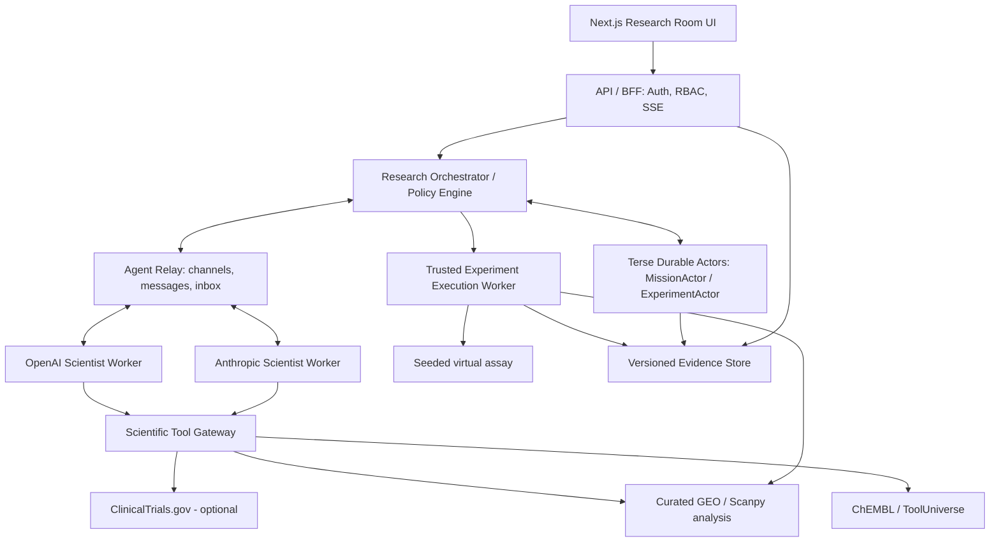
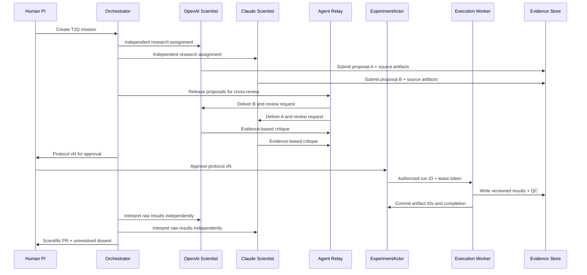
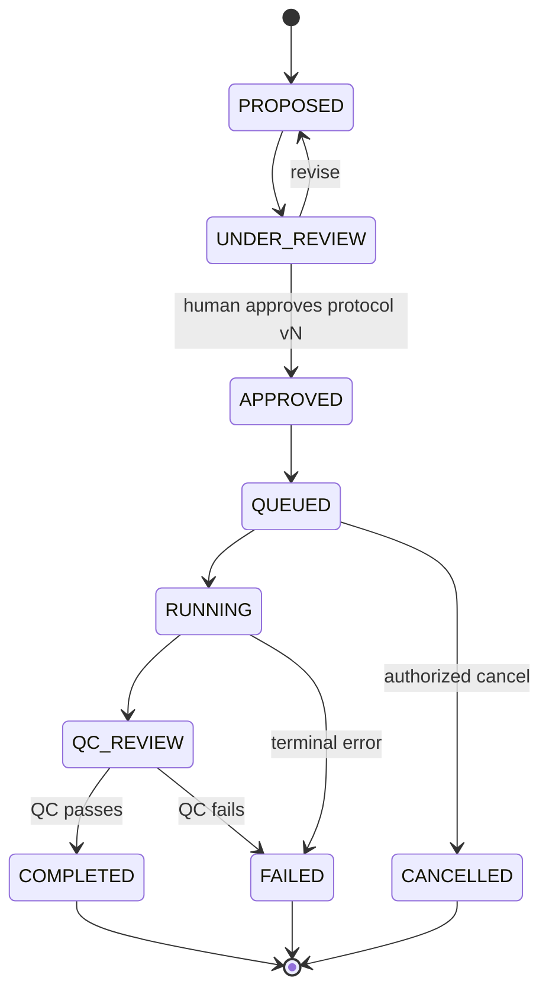
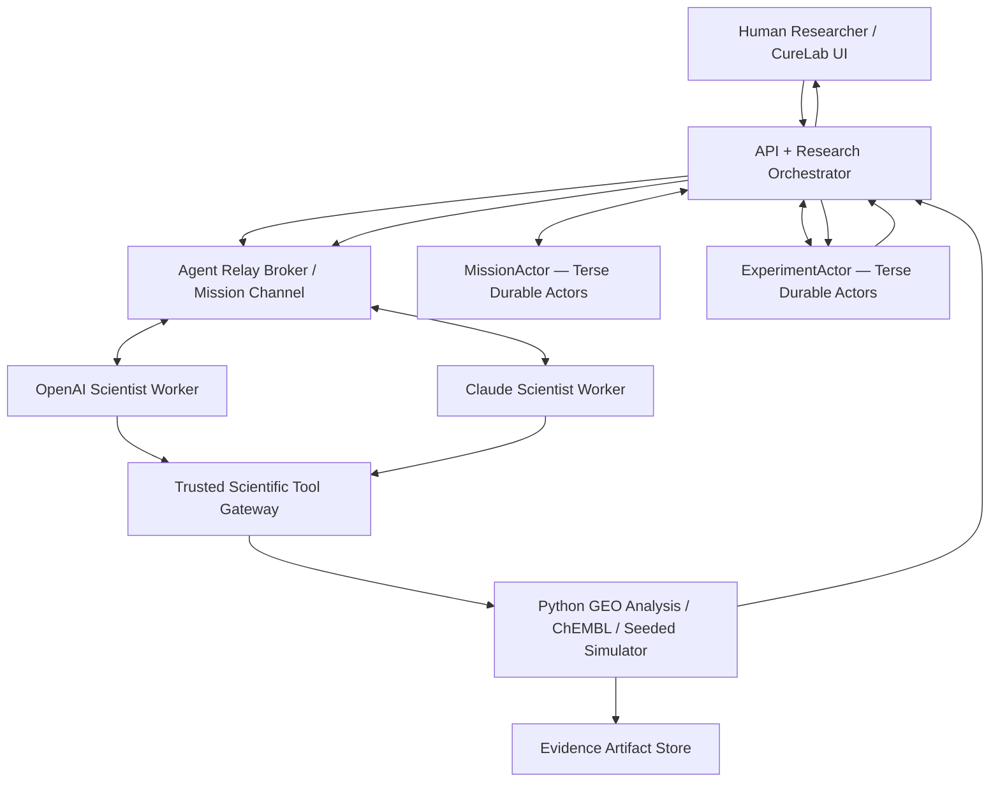
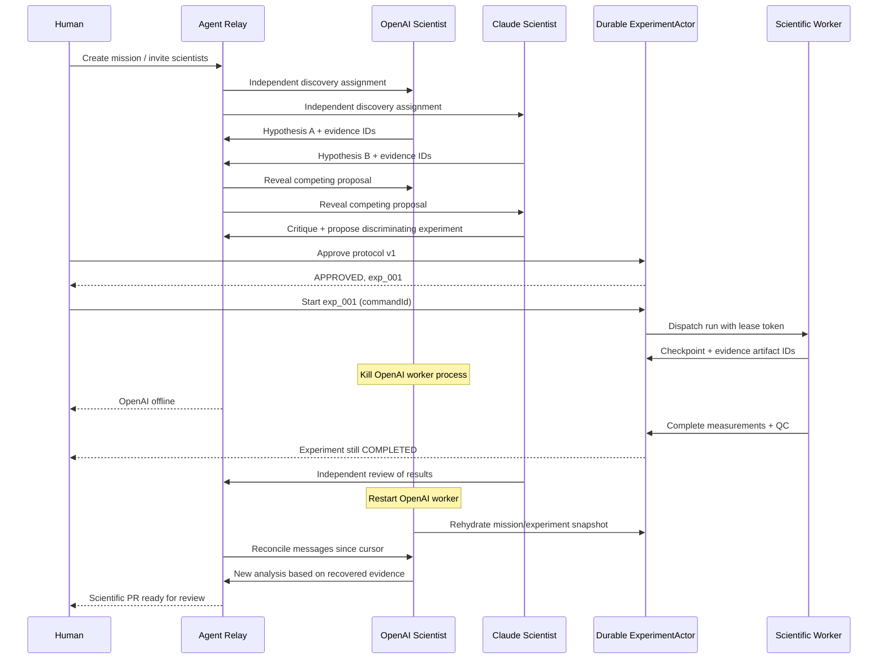

# CureLab — Staff Engineer System Design

**Version:** 1.0 | **Date:** 2026-10-31  
**Context:** YC Haunted Hacks 2026; first research mission is Type 2 Diabetes drug repurposing and β-cell function.  
**Status:** Proposed architecture; SDK APIs, data availability, and vendor capabilities must be verified against pinned versions before implementation.

## 1. Executive summary

CureLab is a **persistent multi-provider scientific research runtime**. OpenAI- and Anthropic-backed scientist workers investigate independently, collaborate over **Agent Relay**, execute authorized analysis/simulation through a trusted Scientific Tool Gateway, and coordinate durable mission/experiment state through **Terse Durable Actors**. Scientific evidence is versioned outside actor state. Human review and evidence provenance are first-class.

**Non-goals:** Claiming discovery of a T2D cure; clinical recommendations; executing real wet-lab experiments in the MVP; training a new drug model; unrestricted access to private ChatGPT/Claude sessions.

### Architecture invariants

1. LLMs propose and interpret; trusted execution workers produce measurements and analysis artifacts.
2. All experiment executions bind to an **approved immutable protocol version**.
3. Relay messages are communication records, **not** authoritative scientific facts.
4. Actor state coordinates workflow, **not** large datasets or long-running computation.
5. Every result is labeled **observed**, **computed**, **simulated**, or **literature-derived**.
6. Independent first-pass reports precede inter-agent review.
7. Retries must not create duplicate committed experiment runs.

## 2. Requirements

### Functional

- Create research mission; enroll human and multiple provider-backed agents.
- Dispatch independent research tasks; access curated GEO, ChEMBL and optional clinical tools.
- Exchange structured proposals/critiques over Agent Relay.
- Human approve experiment protocol version.
- Execute deterministic computational analysis or clearly labeled virtual assay.
- Persist run state, evidence artifacts, checkpoints and review history.
- Recover from agent worker crash; reconcile missed messages and current state.
- Generate Scientific PR with claims, counterarguments, sources and limitations.

### Non-functional

- Auditability, provenance, least privilege, idempotency, deterministic reproduction, observability, budget limits, safe external tool access, graceful degradation.
- MVP targets a single mission and small participant set; production should isolate tenants, support scalable workers and long-running experiments.

## 3. Logical architecture



**Diagram is logical, not a mandatory synchronous call chain.** Orchestrator should submit jobs asynchronously; SSE reads committed events; workers report results via authenticated endpoints.

## 4. Service boundaries

| Component | Owns | Does not own |
|---|---|---|
| Web UI / BFF | Session, auth, read models, approvals, live updates | Scientific computation |
| Research Orchestrator | Task graph, policies, provider assignment, budget | Raw measurements |
| Agent Relay | Agent identity, transport, inbox, collaboration | Final experiment truth |
| MissionActor | Mission phase, participant registry, task IDs, state versions | Large files |
| ExperimentActor | Protocol approval, execution state, idempotency, checkpoint references | Long-running Python process |
| Agent Workers | Independent reasoning, evidence-backed proposals, critiques | Unreviewed execution authority |
| Scientific Tool Gateway | Curated read-only tool contracts, validation, audit | Arbitrary shell/URL execution |
| Execution Worker | Authorized reproducible analysis/simulation and QC | Self-approval of protocol |
| Evidence Store | Data/outputs, provenance, hashes, manifests | Relay message delivery |

## 5. Data and storage

**MVP:** Local SQLite metadata + local versioned artifact files, assuming runtime persistence requirements are met; Durable Actors for authoritative workflow state.  
**Production:** PostgreSQL metadata, S3/R2 content-addressed artifacts, Durable Actors coordination, append-only audit/event table, transactional outbox/inbox.

### Entity relationships

```text
Organization -> ResearchMission
ResearchMission -> Participants (Human, Provider-backed Agents)
ResearchMission -> Hypotheses -> HypothesisVersions -> Claims
ResearchMission -> Experiments -> ProtocolVersions -> Approvals
Experiments -> ExecutionRuns -> Measurements / QC / Artifacts
ResearchMission -> EvidenceArtifacts -> Provenance / DatasetReferences
ResearchMission -> ScientificPR -> Reviews / Dissent / Decision
```

### Canonical types

```typescript
type EvidenceKind =
  | 'observed_public_data'
  | 'computed_analysis'
  | 'simulated_measurement'
  | 'literature_claim';

type ExperimentStatus =
  | 'PROPOSED' | 'UNDER_REVIEW' | 'APPROVED'
  | 'QUEUED' | 'RUNNING' | 'QC_REVIEW'
  | 'COMPLETED' | 'FAILED' | 'CANCELLED';

interface EvidenceArtifact {
  id: string;
  missionId: string;
  kind: EvidenceKind;
  sourceUri: string;
  contentSha256: string;
  datasetVersion?: string;
  protocolVersion?: number;
  toolVersion: string;
  parameters: Record<string, unknown>;
  createdAt: string;
}

interface ExperimentRecord {
  id: string;
  missionId: string;
  hypothesisId: string;
  protocolVersion: number;
  status: ExperimentStatus;
  approvals: string[];
  evidenceIds: string[];
  checkpointId?: string;
  version: number;
}
```

## 6. Workflow and agent independence



**Anti-collusion rule:** First-pass proposals must be committed before either agent sees the other's proposal. Subsequent critique must cite independently retrievable evidence. Avoid treating model agreement as scientific validation.

## 7. Scientific data and open-source skills

| Resource | Role | Integration | Limitation |
|---|---|---|---|
| [GSE81608](https://www.ncbi.nlm.nih.gov/geo/query/acc.cgi?acc=GSE81608) | T2D islet single-cell expression | Curated offline pipeline | Account for donor-level dependence |
| [GSE41762](https://www.ncbi.nlm.nih.gov/geo/query/acc.cgi?acc=GSE41762) | Independent islet expression study | Separate reanalysis | Microarray ≠ single-cell RNA-seq |
| [ChEMBL](https://www.ebi.ac.uk/chembl/) | Compound-target bioactivity | API + cached raw response | Activity ≠ clinical efficacy |
| [HPAP](https://hpap.pmacs.upenn.edu/) | Human islet functional evidence | Future integration | Access/terms must be checked |
| [LINCS](https://lincsproject.org/) | Perturbation expression signatures | Future integration | Cell context matters |
| [ClinicalTrials.gov](https://clinicaltrials.gov/) | Clinical trial registry | Optional read-only connector | Does not prove trial success |
| [ToolUniverse](https://github.com/mims-harvard/ToolUniverse) | Scientific tools integration | Curated gateway adapter | Pin and inspect individual tools |
| [LabClaw](https://github.com/wu-yc/LabClaw) | Agent skill patterns | Reference only / selective use | Verify dependencies and licenses |
| [DrugClaw](https://github.com/QSong-github/DrugClaw) | Drug research skills | Reference only / selective use | Verify released capabilities |
| [TxGNN](https://github.com/mims-harvard/TxGNN) | Drug repurposing hypotheses | Optional precomputed results | Predictions are not discoveries |
| [TDC](https://github.com/mims-harvard/TDC) | Therapeutic ML benchmarks | P1 evaluation | Avoid training during demo |

**Recommended MVP:** Preprocess one GEO study, add a ChEMBL lookup, expose both through typed gateway contracts, and use a seeded simulator for one controllable experiment. Independent GSE41762 reanalysis is P1 if time is tight.

### Tool gateway contracts

```typescript
interface ScientificTools {
  searchDrugEvidence(input: {
    targetGene: string; limit: number;
  }): Promise<EvidenceArtifact[]>;
  analyzeGeoDataset(input: {
    datasetId: string; analysisId: string;
  }): Promise<EvidenceArtifact>;
  proposeExperiment(input: {
    hypothesisId: string; protocol: unknown;
  }): Promise<{ experimentId: string }>;
  getExperimentResults(input: {
    experimentId: string;
  }): Promise<EvidenceArtifact[]>;
}
```

Use Zod/Pydantic validation; restrict tools by mission scope, credentials, rate limits and execution budget. Do not give LLMs arbitrary shell or unbounded URL access.

### Run manifest

```json
{
  "run_id": "run_001",
  "mission_id": "t2d_001",
  "analysis": "beta_cell_signature",
  "dataset": "GSE81608",
  "dataset_sha256": "<calculate-from-actual-bytes>",
  "pipeline_version": "0.1.0",
  "parameters": {
    "cell_type": "beta",
    "comparison": "T2D_vs_control"
  },
  "random_seed": 42,
  "output_artifacts": []
}
```

Hash must be computed, not invented. Preserve sample IDs, donor-level metadata, normalization and QC settings. Do not pool cross-study raw matrices without justified harmonization.

## 8. Durable actor state machine



**Invariant:** `ExecutionRun` references exactly one immutable approved protocol version. Changes require a new version and approval. `ExperimentActor` stores status, idempotency keys, run IDs, lease/fencing token, artifact references and state version; raw matrices live in object storage.

**Exactly-once caveat:** Actor serialization alone does not guarantee exactly-once external effects. Use `commandId` idempotency, `runId`, monotonic fencing tokens, versioned state transitions, and content-addressed artifacts. For future physical experiments, require external lab execution reconciliation and human confirmation.

## 9. Recovery protocol

```text
Agent worker process terminated
  -> independent experiment worker continues (or explicitly pauses)
  -> MissionActor/ExperimentActor retain committed state
  -> replacement agent authenticates
  -> load actor snapshot and latest state version
  -> reconnect Agent Relay inbox from last processed cursor
  -> deduplicate by messageId and commandId
  -> reconcile evidence artifacts and current experiment lease
  -> resume research task and publish new review
```

**Demo requirement:** Kill the actual OpenAI worker process, not just the UI avatar. Show Claude receiving new evidence, restart OpenAI, and prove it responds to information committed while it was offline. Replay a prior command and demonstrate no duplicate committed experiment.

## 10. API and messaging contracts

| Method | Path | Purpose |
|---|---|---|
| POST | `/api/missions` | Create mission |
| GET | `/api/missions/:id` | Read mission |
| POST | `/api/missions/:id/start` | Start independent tasks |
| GET | `/api/missions/:id/events` | SSE stream |
| POST | `/api/experiments` | Propose experiment |
| POST | `/api/experiments/:id/approve` | Human approval |
| POST | `/api/experiments/:id/run` | Queue authorized run |
| GET | `/api/experiments/:id/results` | Read results |
| POST | `/api/missions/:id/pr` | Create Scientific PR |

```typescript
type ResearchMessage = {
  messageId: string;
  missionId: string;
  senderAgentId: string;
  correlationId: string;
  type:
    | 'HYPOTHESIS_PROPOSED'
    | 'EVIDENCE_SUBMITTED'
    | 'CRITIQUE_REQUESTED'
    | 'CRITIQUE_COMPLETED'
    | 'EXPERIMENT_PROPOSED'
    | 'EXPERIMENT_COMPLETED'
    | 'RESEARCH_HANDOFF';
  payload: Record<string, unknown>;
  timestamp: string;
};
```

Relay carries these business payloads; CureLab owns schema validation and authorization. Use a transactional outbox/inbox or reconciliation worker to handle state-change/message-delivery partial failures.

## 11. Security, safety, scientific trust

- **Authorization:** Mission-scoped tokens, human-only approval, role-based tool access.
- **Prompt injection:** Treat retrieved papers, APIs and tool outputs as untrusted data.
- **Provenance:** Verify PMID/DOI/accession references; preserve source URI and retrieval timestamp.
- **Measurement integrity:** Only trusted execution workers can submit computed or simulated measurements.
- **Secrets:** API keys on server only; never in relay chat or tool output.
- **Tenant isolation:** Separate mission data, artifacts and agent credentials.
- **Scientific integrity:** Distinguish statistical association from causality and preclinical findings from patient benefit.
- **Audit:** Append-only log of approvals, commands, state transitions, results and reviewer decisions.

## 12. Observability and SLO candidates

| Dimension | Measure |
|---|---|
| Reliability | Crash recovery success, orphaned runs, duplicate committed runs |
| Traceability | Fraction of claims with validated evidence and provenance |
| Reproducibility | Same input + version + seed produces same output hash |
| Collaboration | Independent critiques, corrected claims, unresolved disagreements |
| Performance | Time to first proposal, tool latency, experiment turnaround |
| Cost | Tokens and external tool spend per mission |

MVP acceptance tests: distinct provider requests; independent first-pass proposals; one real evidence-backed critique; reproducible experiment; actual crash and recovery; no duplicate committed run; Scientific PR with clear provenance.

## 13. Implementation plan — six-hour hackathon

| Time | Workstream | Deliverable |
|---|---|---|
| 00:00–00:40 | Project skeleton + curated data | UI/API scaffold, data artifact |
| 00:40–01:35 | Durable Actors | MissionActor, ExperimentActor, state machine |
| 01:35–02:30 | Agent Relay + provider workers | Two independent model-backed agents |
| 02:30–03:20 | Scientific Tool Gateway | GEO analysis + ChEMBL lookup |
| 03:20–04:15 | Living Experiment | Seeded assay, QC, artifact provenance |
| 04:15–05:00 | UI + Scientific PR | Room, experiment panel, review artifact |
| 05:00–05:35 | Recovery | Kill/restart/reconcile without duplication |
| 05:35–06:00 | Integration + rehearsal | Validated 3-minute demo and backup recording |

**Feasibility warning:** This is an aggressive plan. Validate SDK capabilities and credentials at the start, pin versions, and drop clinical forecasting, DDI, training, and elaborate visual polish if integration runs late. Respect hackathon rules requiring code to be created during the event.

## 14. Technology choices

| Layer | MVP choice | Production direction |
|---|---|---|
| Frontend | Next.js / React / Tailwind | Same + role-aware UI |
| BFF/orchestrator | TypeScript / Zod | Separate scalable services |
| Agent workers | OpenAI + Anthropic SDKs | Provider-agnostic adapters |
| Messaging | Agent Relay | Authenticated cross-org relay |
| Workflow state | Terse Durable Actors | Versioned actor contracts and recovery |
| Scientific analysis | Python / pandas / scipy / Scanpy as needed | Isolated job workers and reproducible containers |
| Scientific tools | Curated ToolUniverse + ChEMBL | Capability registry + sandboxing |
| Evidence | SQLite/local files (demo) | PostgreSQL + S3/R2 |
| Live updates | SSE | Event bus + SSE/WebSocket |
| Telemetry | Structured logs + correlation IDs | Distributed tracing + metrics |

## 15. Architecture decisions (ADRs)

- **ADR-001:** Relay is communication, not authoritative evidence.
- **ADR-002:** Actors coordinate, but never hold large datasets or block on long-running analysis.
- **ADR-003:** Independent first pass precedes collaboration.
- **ADR-004:** Every artifact carries a strict provenance type.
- **ADR-005:** Trusted workers produce measurements; human approves protocol.
- **ADR-006:** Scientific PR is the primary reviewable output.
- **ADR-007:** No new model training for MVP.
- **ADR-008:** Recovery is tested by process termination, not visual simulation.

## 16. Open questions and decisions before coding

1. Verify **current Terse Durable Actors and Agent Relay SDK** APIs, durability semantics and deployment constraints.
2. Decide whether Python execution runs as subprocess, container, or independent service; do not block actors.
3. Check source dataset access and license, cache permissible artifacts and compute hashes.
4. Define experiment simulator parameters and deterministic QC-failure scenario.
5. Choose minimal Scientific PR schema and display format.
6. Ensure actual provider keys and API limits are available; keep fallback demo safe and labeled.

## 17. Final recommendation

**Approve the architecture with strict MVP scope.** The differentiator is not a drug ranking model; it is the verifiable workflow: **independent AI discovery → adversarial collaboration → authorized experiment → durable recovery → Scientific PR**. First prove this with one T2D mission and a small number of trusted scientific tools; then extend to clinical evidence, drug safety, additional datasets, physical lab integrations, and Mearc Research Passport.

---

## 18. Hackathon sponsor integration — BOTH Durable Actors and Agent Relay (required)

**Decision: implement both sponsor technologies in the real execution path, not just in the UI.** Agent Relay is the communication transport; Terse Durable Actors are the authoritative persistent workflow state. The two must be integrated by an application orchestrator, with idempotent commands and an event/outbox bridge. Neither component substitutes for the other.

### 18.1 Architecture and ownership



**Agent Relay owns:** agent identities and live messaging, the `mission:<id>` channel, critique/proposal/handoff messages, agent presence/exit signals, and delivery-related events. The relay is *not* the experiment database.

**MissionActor owns:** mission status, participating agent identities, independent-first-pass barrier, proposal references, review round, processed command IDs, and event sequence.

**ExperimentActor owns:** immutable approved protocol version, approval identity, experiment state, active run/lease token, progress checkpoint, output artifact references, QC decision, and processed command IDs. Large GEO matrices and results live in artifact storage, not actor fields.

**Orchestrator owns:** authorization, translation of relay messages to actor commands, policy gates, retries, and relay event publishing. No Agent can directly mutate approved experimental evidence.

### 18.2 Event contract

```typescript
interface ResearchEnvelope<T> {
  eventId: string;         // globally unique, used for deduplication
  missionId: string;
  experimentId?: string;
  correlationId: string;
  senderId: string;
  type: 'HYPOTHESIS_PROPOSED' | 'CRITIQUE_POSTED' |
        'EXPERIMENT_PROPOSED' | 'EXPERIMENT_APPROVED' |
        'EXPERIMENT_PROGRESS' | 'EXPERIMENT_COMPLETED' |
        'AGENT_OFFLINE' | 'AGENT_RESUMED';
  payload: T;
  emittedAt: string;
}
```

**Critical sequencing:** receive message -> validate identity/schema -> invoke actor command with `eventId` as idempotency key -> persist actor state/event -> publish notification to Relay/UI. If notification fails, an outbox/reconciler retries it. This is at-least-once delivery with application-level deduplication, **not** blanket exactly-once execution.

### 18.3 End-to-end sponsor demonstration



### 18.4 Concrete implementation and SDK verification

Terse official quickstart (https://docs.useterse.ai/quickstart) documents Bun, `bunx terse-cli@latest install`, `terse init`, `terse actor dev`, `terse actor generate`, `terse deploy`, `@Persisted`, `@Emittable`, and generated actor clients. Begin from the **official template**, adapt its persisted fields, and regenerate the client after actor changes. Do not assume Cloudflare Durable Objects APIs are identical to Terse SDK APIs.

Agent Relay TypeScript SDK reference (https://agentrelay.com/docs/typescript-sdk) documents `npm install @agent-relay/sdk`, `AgentRelay`, `spawnAgent`, `sendMessage`, `human`, `addListener('agentExited', ...)`, and broker messaging. For true cross-provider independence, use separate OpenAI and Anthropic model-backed workers (or supported CLI harnesses) and verify that both are actually sending/receiving via the Relay broker. Avoid a mock `relay` facade that only updates local React state.

**Suggested P0 implementation order:**
1. Start a real Terse actor; prove persisted mission/experiment state survives a client or worker restart.
2. Start the real Agent Relay broker; exchange a message between two independently running model-backed agents.
3. Create a `mission:<id>` collaboration channel and emit structured hypothesis/critique events.
4. Connect `EXPERIMENT_PROPOSED` -> human approval -> `ExperimentActor` transition -> trusted Python experiment worker.
5. Kill one model worker, let experiment continue, reconnect worker, load actor snapshot, replay/reconcile Relay messages, and submit a new analysis.
6. Show IDs, logs, persisted checkpoints, and deduplicated measurement count on screen.

### 18.5 Acceptance tests and judge evidence

| Test | Pass condition | Proof on screen |
|---|---|---|
| Both sponsor products | Actual Terse actor calls AND Agent Relay broker messages | Logs/IDs from both systems |
| Cross-provider | OpenAI and Claude have separate real model invocations | Distinct worker/process identities and responses |
| Persistence | Experiment remains in correct state after worker termination | Same `experimentId`, protocol version, checkpoints |
| Recovery | Restarted worker reasons over evidence created while offline | New post-restart critique referencing artifact ID |
| Idempotency | Resend same completion event twice | One committed result/artifact reference |
| Human control | No experiment run before approval | Rejected unapproved transition |
| Scientific honesty | Simulation is not presented as real wet-lab data | `simulated_measurement` label and manifest |

**Demo headline:** “Two AI scientists. One shared experiment. One scientist crashes. The science survives.”

**Risk / fallback:** If provider-specific harnesses are incompatible with Relay SDK, run separate API-backed workers with an explicit Relay broker adapter; if the actor SDK differs from the conceptual interface, use the official generated client. Do not fake sponsor integrations to meet the requirement.
