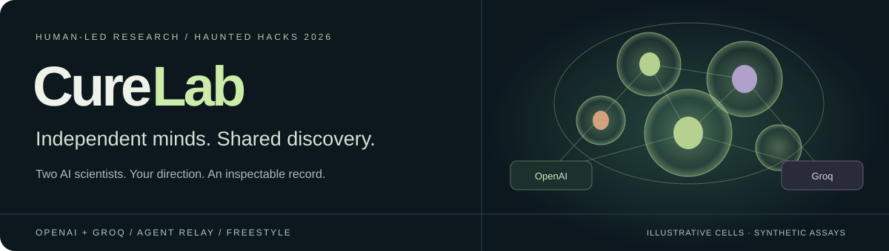
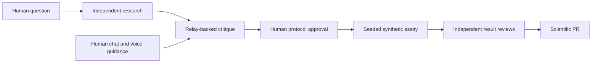
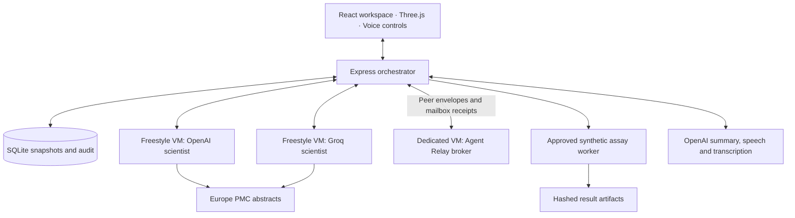

<p align="center">
  
</p>

<p align="center"><strong>Your voice-directed lab, where AI scientists debate and test ideas in simulation.</strong></p>

<p align="center">
  <a href="#quick-start">Quick start</a> ·
  <a href="#the-research-experience">Features</a> ·
  <a href="#architecture">Architecture</a> ·
  <a href="docs/DEMO_SCRIPT.md">Demo script</a> ·
  <a href="CureLab_System_Design.md">System design</a>
</p>

<p align="center">
  
  
  
</p>

## Research you can question

AI-generated research is difficult to trust when its sources, assumptions and disagreements are hard to inspect. CureLab gives the researcher a seat at the discussion: two independent scientists investigate a specific question, challenge each other’s conclusions and respond to human guidance.

**OpenAI and Groq reason independently. Agent Relay carries their peer messages. You approve the experiment.** The resulting research record keeps evidence, results and dissent together.

> **Scientific scope:** CureLab currently runs seeded synthetic assays. Its literature retrieval and configured provider integrations are real; its experiment measurements are generated by a toy simulator, not a wet lab or a validated biological model.

## The research experience

| Capability | What you can do |
| --- | --- |
| **Independent AI scientists** | Give OpenAI and Groq the same question. Their first reports stay private until both are committed. |
| **Connected discussion** | Follow peer critiques and replies delivered through Agent Relay, with inspectable delivery records. |
| **Voice research roundtable** | Hear one- or two-sentence summaries, interrupt with a suggestion, review its transcript and share it with both scientists. Full messages stay in chat. |
| **Individual workspaces** | Expand each scientist’s Freestyle VM details, jobs, reports, logs and paper reading desk independently. |
| **3D cell observatory** | Explore illustrative pancreatic islets, individual cells and conceptual signaling with Three.js. |
| **Human-approved experiments** | Review and approve an exact protocol version before a reproducible simulation runs. |
| **Interactive results** | Explore time courses, group means, distributions, secretion–viability scatter and well heatmaps. Inspect exact values and export SVG or CSV. |
| **Scientific PR** | Review both scientists’ conclusions, preserve disagreements and export the research bundle with its audit trail. |

### From question to research record



Human guidance informs subsequent discussion; it does not bypass protocol approval. The initial protocol comes from an editable template rather than an autonomous experimental planner.

### Our first case: pancreatic β-cell function

**Question:** How does Candidate A affect simulated insulin secretion and viability at a fixed glucose concentration?

| Parameter | Default |
| --- | --- |
| Candidate | Candidate A — placeholder compound |
| Dose / glucose | 10 µM / 11 mM |
| Groups | Vehicle · Candidate · Positive control |
| Replicates | 8 per group; 24 wells total |
| Random seed | 42 |
| Readouts | Relative insulin secretion and cell viability |

The simulator reports well-level measurements, summary statistics, generated time curves and QC checks. Reusing the same parameters and seed reproduces the same measurements. The candidate response is encoded in the simulator’s equations; changing a compound name does not invoke a real drug model.

## Quick start

Requires **Node.js 24+** and npm. Node’s built-in SQLite support stores local mission state.

```bash
git clone https://github.com/luxinlabs/mearc-curelab.git
cd mearc-curelab
npm install
cp .env.example .env
```

Choose a mode before starting. The supplied `.env.example` targets the live integrations; for a credential-free preview, change these values in `.env`:

```dotenv
CURELAB_MODE=demo
CURELAB_RUNTIME=local
CURELAB_TRANSPORT=local
CURELAB_VOICE=false
```

```bash
npm run dev
```

Open **[localhost:3000](http://localhost:3000)**. The **[product showcase](http://localhost:3000/showcase.html)** presents the features, technology and judging walkthrough.

Demo mode uses explicitly scripted scientists and synthetic measurements. It makes no model, literature or voice API calls. Local transport does not demonstrate Agent Relay.

<details>
<summary><strong>Configure live research, VMs and Relay</strong></summary>

Set the following in `.env`, using keys and model access available to your accounts:

```dotenv
CURELAB_MODE=live
OPENAI_API_KEY=your-openai-key
OPENAI_MODEL=gpt-5.4
GROQ_API_KEY=your-groq-key
GROQ_MODEL=openai/gpt-oss-120b

CURELAB_RUNTIME=freestyle
FREESTYLE_API_KEY=your-freestyle-key

CURELAB_TRANSPORT=agent-relay
RELAY_BROKER_URL=https://your-broker-host
RELAY_BROKER_API_KEY=your-broker-token

CURELAB_VOICE=true
OPENAI_TTS_MODEL=gpt-4o-mini-tts
OPENAI_TRANSCRIBE_MODEL=gpt-transcribe
OPENAI_SCIENTIST_VOICE=nova
GROQ_SCIENTIST_VOICE=onyx
```

Provision the broker using the [operations guide](docs/OPERATIONS.md#agent-relay-track). Restart the server after changing configuration and create a new mission to select the new runtime/transport. Keys remain server-side; `.env` is ignored by Git. Provider failures are displayed and never silently replaced with scripted replies.

To use live models without remote VMs, explicitly select `CURELAB_RUNTIME=local`. To use local peer delivery, select `CURELAB_TRANSPORT=local`; this mode is not Relay-backed.

</details>

<details>
<summary><strong>Use the voice roundtable</strong></summary>

1. Click **Listen to discussion** or **Test voice** to unlock browser audio.
2. Shared critiques, discussions and replies are summarized aloud. Independent proposals are silent.
3. Click **Speak / interrupt**, record your suggestion, then **Finish speaking**.
4. Review the transcript and select **Share with both scientists**, or resume without a note.

OpenAI uses `nova`; Groq uses `onyx`. Both are synthetic OpenAI voices. A separate model call creates a concise spoken summary while preserving the full research message. This is buffered, turn-based speech with click-to-interrupt recording, not a full-duplex audio call. Use localhost or HTTPS for microphone access.

See [voice operation and API compatibility](docs/OPERATIONS.md#voice-research-roundtable) for limits and troubleshooting.

</details>

## Architecture



The orchestrator sends peer envelopes through the official Relay broker, retrieves the recipient’s message and supplies that received context to the scientist VM. Relay transports text; speech is generated separately. Local workers are also supported for development and demo mode.

SQLite preserves committed missions, approvals, jobs, messages and checkpoints. Result artifacts carry SHA-256 hashes. The app binds to `127.0.0.1` and is a local, single-user prototype; its session checks are not production multi-user authentication.

## Integrations and data provenance

| Technology | Role | Status |
| --- | --- | --- |
| **OpenAI** | Research scientist, spoken summaries, synthesis and human transcription | Implemented; credentials required |
| **Groq** | Independent second scientist | Implemented; credentials required |
| **Freestyle** | Separate scientist VMs and broker infrastructure | Implemented; credentials required |
| **Agent Relay** | Broker-based peer message delivery | Implemented; broker setup required |
| **Europe PMC** | Paper metadata and available abstracts | Retrieved during live proposals; provenance recorded |
| **React / Three.js / SQLite** | Workspace, illustrative cells and durable local state | Implemented |
| **GEO / ChEMBL** | Suggested future research sources | No dataset analysis implemented |
| **Terse / OpenEvidence** | Potential future integrations | Not connected |

Provider names identify technologies used, not endorsements or a claim that every provider sponsors the event. The hackathon track targeted is **agent-to-agent communication with Agent Relay**.

Paper abstracts provide discussion context; they do **not** generate or calibrate the experiment measurements. Simulated confidence intervals describe simulator noise, not clinical uncertainty. Cells are procedural illustrations rather than reconstructed tissue.

## Development and validation

```bash
npm test           # Automated workflow, provider, transport, data and voice tests
npm run build      # Production frontend build
npm start          # Serve the production build locally
```

Tests cover reproducibility, QC, exact-version approval, retries and recovery, independent research barriers, Relay error handling, provider routing, chart data and voice playback/summary behavior. Passing tests does not establish scientific validity or live account access.

Live Freestyle/provider connectivity and bidirectional broker checks have been performed; scope and limits are documented in the [operations guide](docs/OPERATIONS.md) and [Relay verification report](AGENT_RELAY_VERIFICATION.md). Browser layout, speaker output and microphone interaction still require rehearsal on the presentation laptop.

| Location | Responsibility |
| --- | --- |
| [`src/`](src/) | Research workspace, cells, charts, agent observatory and voice UI |
| [`server/lab.mjs`](server/lab.mjs) | Mission orchestration, approvals, jobs and reviews |
| [`server/simulator.mjs`](server/simulator.mjs) | Synthetic measurements and QC |
| [`server/relay.mjs`](server/relay.mjs) | Official broker adapter and delivery validation |
| [`server/voice.mjs`](server/voice.mjs) | Speech and transcription routes |
| [`server/voice-summary.mjs`](server/voice-summary.mjs) | Brief spoken summaries and validation |
| [`server/store.mjs`](server/store.mjs) | SQLite persistence and audit records |
| [`tests/`](tests/) | Automated regression tests |
| [`public/showcase.html`](public/showcase.html) | Static product and technology showcase |

## Explore further

- **[Demo script](docs/DEMO_SCRIPT.md)** — two-minute β-cell walkthrough with an optional extension.
- **[Operations guide](docs/OPERATIONS.md)** — Freestyle, broker setup, voice controls, storage and troubleshooting.
- **[System design](CureLab_System_Design.md)** — implemented architecture in §0; later sections include future plans.
- **[Relay verification](AGENT_RELAY_VERIFICATION.md)** — actual integration evidence and delivery limitations.

---

<p align="center"><strong>Ask a sharper question. Hear both perspectives. Keep the human in control.</strong><br><sub>Built for Haunted Hacks 2026.</sub></p>
